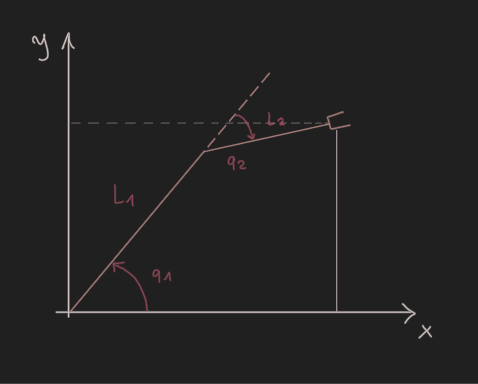
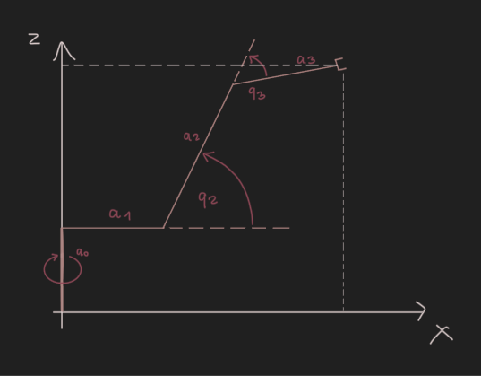

# Jacobian Path Planning Example

This MATLAB/Simulink project demonstrates Jacobian-based path planning with selectable robot models and controller algorithms. The model uses fixed three-element interfaces, so changing a selection does not require rewiring the diagram.

## Files

- `JacobianAlgorithms.prj` - MATLAB project file.
- `jacobian_path_planning.slx` - top-level Simulink model.
- `create_path_planning_model.m` - recreates the model and its selectable blocks.
- `setup_project.m` - adds the folder to the MATLAB path and initializes defaults.
- `run_example.m` - runs the default configuration and plots the result.

## Requirements

- MATLAB R2024a or newer
- Simulink
- MATLAB Function blocks

## Quick start

```matlab
setup_project
run_example
```

The default configuration is:

| Selection | Value | Meaning |
|---|---:|---|
| `model_selection` | `1` | Two-link planar arm |
| `algorithm_selection` | `1` | Damped Jacobian |

Both selectors are visible in `jacobian_path_planning.slx` as the **Model Selection** and **Algorithm Selection** Constant blocks. Change their values to `1` or `2`, update the diagram, and run the simulation:

```matlab
model_selection = 2;
algorithm_selection = 2;
target = [0.9; 0.4; 0.8];
sim('jacobian_path_planning')
```

The corresponding `Multiport Switch` blocks select the active implementation:

- **Model Selector q** and **Model Selector position** select the robot model.
- **Algorithm Selector** selects the planner.

## Model choices

### Model 1 - two-link planar arm




The arm uses link lengths `L1` and `L2`:

```text
x = L1*cos(q1) + L2*cos(q1 + q2)
y = L1*sin(q1) + L2*sin(q1 + q2)
z = 0
```

The fixed three-element state is `[q1; q2; 0]`. Only the first two target coordinates are used.

### Model 2 - three-joint manipulator



The model uses parameters `a0`, `a1`, `a2`, and `a3`:

```textx
A = a1 + a2*cos(q2) + a3*cos(q2 + q3)
x = cos(q1)*A
y = sin(q1)*A
z = a0 + a2*sin(q2) + a3*sin(q2 + q3)
```

The target is the full three-element vector `[x; y; z]`. Its Jacobian is evaluated numerically with central differences.

## Algorithm choices

### Algorithm 1 - damped Jacobian

The planner uses damped least squares:

```text
q_dot = J' * (J*J' + lambda^2*I)^(-1) * Kp*e
```

with `lambda = 0.05`. Damping improves behavior near singular configurations.

### Algorithm 2 - pseudoinverse transposition tradeof

The planner uses the Moore-Penrose pseudoinverse and transposition tradeof, scaled based on lambda:

```text
q_dot = J' * (J*J'*(lambda) + (1-lambda)*I)^(-1) * Kp*e
```

Both algorithms apply component-wise joint-speed saturation using `max_joint_speed`.

## Workspace variables

```matlab
L1 = 1.0;
L2 = 0.8;
a0 = 0.2;
a1 = 0.6;
a2 = 0.5;
a3 = 0.35;
initial_q = [0; 0; 0];
target = [1.25; 0.65; 0.2];
Kp = 2.0;
max_joint_speed = 1.5;
simulation_time = 8.0;
model_selection = 1;
algorithm_selection = 1;
```

The model logs `q_log` and `end_effector_log` to the simulation output. `run_example(false)` runs without creating plots, which is useful for automated tests.
